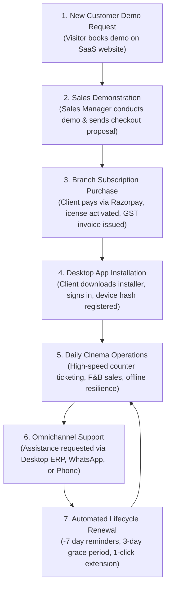

# 🏛️ Royal Cinema ERP — System Architecture & Multi-Interface Blueprint

**One Platform. Every Cinema Operation.**  
A scalable cinema enterprise management SaaS engineered for single-screen cinemas, twin multiplexes, and multi-branch cinema chains.

---

## 1. The 4 System Interfaces

Royal Cinema ERP cleanly separates user workflows into **4 primary interfaces**, all operating on top of a single, centralized, multi-tenant SaaS backend:

```
┌────────────────────────────────────────────────────────────────────────────────────────┐
│                                   SHARED SAAS BACKEND                                   │
│    Auth (JWT/Cognito)  •  Tenant Isolation  •  Subscriptions  •  APIs  •  Lead CRM     │
└───────┬──────────────────────────┬──────────────────────────┬───────────────────┬──────┘
        │                          │                          │                   │
        ▼                          ▼                          ▼                   ▼
┌───────────────────┐      ┌──────────────────┐       ┌─────────────────┐ ┌───────────────┐
│ A. PUBLIC WEBSITE │      │  B. DESKTOP ERP  │       │ C. CLIENT PORTAL│ │D. SUPER ADMIN │
│                   │      │                  │       │                 │ │               │
│ • Home & Hero     │      │ • Box Office POS │       │ • Subscription  │ │ • Tenant Ops  │
│ • 12 Modules      │      │ • F&B Concession │       │ • Branch Mgmt   │ │ • Revenue     │
│ • Pricing (Branch)│      │ • Command Center │       │ • Staff Users   │ │ • Demo Leads  │
│ • Demo Request    │      │ • 80mm Print     │       │ • Renewals      │ │ • Platform BI │
└───────────────────┘      └──────────────────┘       └─────────────────┘ └───────────────┘
```

### Interface A: Public SaaS Website
- **Target Persona:** Prospective cinema owners, multiplex general managers, visitors.
- **Goal:** Product education, module exploration, trust building, transparent per-branch pricing, and high-conversion demo request lead capture.
- **Implementation:**
  - Standalone Production: `resources/app/saas-website.html` (Accessible via `http://localhost:3000/website`).
  - Next.js Production Route: `frontend-nextjs/src/app/(marketing)/page.tsx`.
- **Pages / Sections Covered:**
  - **Home:** Hero, benefits, 4 pillars (Per Branch, Monthly/Yearly, Demo First, Complete Support), interactive workstation preview, CTA.
  - **Features:** 12 enterprise categories (Ticket Booking, Online Booking, Counter POS, F&B Concessions, Pre-Food, Shows, Staff RBAC, CRM, Inventory, Analytics, Multi-Branch, Financial Reports).
  - **Solutions:** Single-Screen, Multiplex, Multi-Branch Cinema Chains.
  - **Pricing:** Per-branch pricing, Monthly vs Yearly billing switch (20% off).
  - **How It Works:** 4-step roadmap from demo to installation.
  - **Book a Demo:** Working lead capture form connected to `/api/sales/demo-request`.
  - **About Us & Contact:** Team, corporate information, telephone & WhatsApp direct hotline.
  - **FAQ:** Interactive hardware, print, offline resilience, and GST compliance accordion.
  - **Legal Policies:** Privacy Policy, Terms of Service, Refund & Guarantee Policy.

### Interface B: Royal Cinema ERP Desktop
- **Target Persona:** Box office cashiers, ticket checkers, food counter attendants, projectionists.
- **Goal:** Fast, offline-resilient, crash-proof box office operations. Under 3-second ticket sales and 80mm thermal receipt output.
- **Implementation:**
  - Electron Desktop Shell: `resources/app/main.cjs` + `preload.cjs`.
  - Operational Workspaces:
    - `city_lite_cinema_erp_multi_counter_role_login.html` (Box Office Counter POS)
    - `city_lite_f_b_counter_pos_role_login.html` (F&B Concessions Terminal)
    - `city_lite_cinema_erp_command_center_role_login.html` (Command Center & Projection Telemetry)
    - `customer-ticket-booking.html` (Mobile Web Customer Booking)

### Interface C: Client Portal
- **Target Persona:** Subscribed cinema owner, branch manager, accountant.
- **Goal:** License management, annual renewal (+1 year extension without data loss), staff accounts provisioning, GST ledger downloads.
- **Implementation:**
  - Integrated Client Management Dashboard in `resources/app/index.html` (`#adminMasterPanel`).

### Interface D: Super Admin Portal
- **Target Persona:** Royal Cinema SaaS platform operators, global administrators.
- **Goal:** Multi-company tenant governance, subscription suspensions/activations, incoming sales demo leads pipeline, aggregate ARR/MRR revenue auditing.
- **Implementation:**
  - Super Admin Console in `resources/app/index.html` (`#superAdminConsole`) + NestJS `@Roles(UserRole.SUPER_ADMIN)` endpoints.

---

## 2. Shared SaaS Backend Specifications

The backend handles core business logic centrally, ensuring complete data consistency across all 4 interfaces:

1. **Multi-Tenant Isolation:**
   - Every database record (movies, shows, seat maps, transactions, staff) carries an immutable `companyId` / `tenantId`.
   - Cross-tenant data leakage is prevented via strict query middleware and tenant guards.

2. **Per-Branch Licensing & Screen Constraints:**
   - Subscriptions are tracked per physical branch location.
   - The subscribed plan (1 Screen Starter, 2 Screen Twin Multiplex, 4 Screen Multiplex Pro) dynamically provisions the exact screen count enabled across counter POS workstations.

3. **Dual Billing Engine:**
   - Support for Monthly and Annual billing cycles with automated validity calculation (`validTill = now + 365 days` for yearly).
   - In-app 1-click renewal flow extending validity without overwriting cinema history.

4. **Automated Sales & Demo Pipeline:**
   - Public website submissions immediately dispatch Sales Enquiries into `demo_enquiries.json` / MongoDB.
   - Real-time notification trigger via WhatsApp webhook & email alert to sales engineering.

---

## 3. Omnichannel Support Architecture (Section 10 Blueprint)

The support infrastructure connects 5 real-time communication channels into a centralized engine:

| Channel | Primary Usage | SLA & Priority Trigger | Fail-Safe Mechanism |
|---|---|---|---|
| **Dashboard Alerts** | Primary operational alerts | Live badge update via WebSocket / Polling | Permanent local append; zero network drop |
| **Gmail SMTP / SES** | Invoices, ticket updates, daily digest | All tickets, billing notices | Retry queue; logs fallback to dashboard |
| **WhatsApp Business API** | Urgent operational incidents | Critical (15 min SLA) & High (1 hr SLA) | Meta approved templates (`critical_incident_alert_v1`) |
| **Priority Phone Calls** | Immediate hardware / showtime blockages | Customer-triggered callback requests | 15-minute dispatch target to on-duty manager |
| **Live Chat** | Real-time troubleshooting | Embedded in POS & Client Portal | WebSockets stream with local transcript archive |

### Notification Preferences Engine (Super Admin Controlled)
- `newTicketEmail`: ON / OFF
- `criticalTicketWhatsApp`: ON / OFF
- `newCallbackRequest`: ON / OFF
- `newChatMessage`: ON / OFF
- `paymentFailureAlert`: ON / OFF
- `subscriptionExpiryAlert`: ON / OFF
- `dailySummaryEmail`: ON / OFF

---

## 4. SaaS Support Team Roles & RBAC Matrix (Section 11 Blueprint)

SaaS administrative personnel roles are strictly partitioned from cinema branch operator accounts:

| SaaS Role | Permission Scope | Bound & Safeguards |
|---|---|---|
| **Super Admin** | Full root platform control, pricing overrides | Every sensitive action is written to immutable `audit_logs` |
| **Support Manager** | All customer tickets, team assignment, SLA monitoring | Cannot change subscription plan pricing or bank accounts |
| **Support Agent** | View & reply only to assigned tickets | Cannot delete tickets or view financial revenue reports |
| **Technical Support** | Diagnostics, hardware driver logs, POS troubleshooting | Strictly cannot alter production databases without Super Admin approval |
| **Billing Admin** | Invoices, Razorpay transactions, GST ledgers, refunds | Cannot delete or resolve customer operational complaints |
| **Sales Manager** | Demo leads pipeline, conversion checkout proposals | Cannot access technical diagnostic sessions or system configs |
| **Release Manager** | Desktop installer packaging, OTA update publish, SHA256 hashes | Cannot access financial transactions or support tickets |

---

## 5. Backend Architecture & NestJS Modules (Section 12 Blueprint)

Base URL: `/api/v1`

```
enterprise-production/backend-nestjs/src/
├── auth/            # JWT authentication, session tokens, MFA
├── organizations/   # Master tenant companies (e.g. Royal Cinema Group)
├── branches/        # Physical cinema locations (Ahmedabad, Gandhinagar, Surat)
├── users/           # User accounts & corporate identity mapping
├── plans/           # Starter (1 Screen), Professional (2 Screens), Enterprise (4 Screens)
├── subscriptions/   # Per-branch subscription lifecycle, renewals, grace period
├── payments/        # Razorpay orders, signed webhook validation, refunds
├── invoices/        # GST SAC 999632 automated invoice generation & PDF links
├── licenses/        # Device hardware binding, activation, and validation
├── downloads/       # Windows x64 Desktop installer (v0.3.0) distribution
├── support/         # Support tickets, priority pills, SLA countdowns, replies
├── chat/            # Real-time WebSocket support conversations
├── calls/           # Immediate callback requests and manager call logs
├── notifications/   # Omnichannel dispatcher (Gmail, WhatsApp, in-app)
├── releases/        # Desktop OTA update manager & version manifests
├── analytics/       # MRR, ARR, ticket SLA compliance, active POS counts
└── audit-logs/      # Immutable administrative activity records
```

---

## 6. MongoDB Database Collections & Tenant Scoping (Section 13 Blueprint)

Strict **Tenant Isolation** is enforced at the database layer. Every record is scoped with:
- `organizationId`: Root customer entity
- `branchId`: Physical cinema establishment

```
Organization (1) ────< Branch (N) ────< Subscription (1 per branch)
                        │
                        ├────< License (1 per branch)
                        │        └────< Devices (N per screens limit)
                        │
                        ├────< Support Tickets (N)
                        │        └────< Messages (N)
                        │
                        └────< Invoices (N)
```

### Collections Schema:
1. `organizations`: `{ organizationId, name, ownerEmail, gstin, status }`
2. `branches`: `{ organizationId, branchId, branchName, city, screensCount, status }`
3. `plans`: `{ planId, name, screensAllowed, monthlyPrice, yearlyPrice }`
4. `subscriptions`: `{ organizationId, branchId, planId, billingCycle, validTill, status, gracePeriodDays }`
5. `invoices`: `{ organizationId, branchId, invoiceNumber, amount, sacCode, status, pdfUrl }`
6. `licenses`: `{ organizationId, branchId, licenseKey, devicesLimit, activatedDeviceHashes }`
7. `devices`: `{ branchId, deviceId, name, hardwareHash, lastActive, status }`
8. `support_tickets`: `{ organizationId, branchId, subject, priority, status, assignedAgentId, slaTargetMinutes }`
9. `notifications`: `{ type, title, message, channelsDispatched, timestamp }`
10. `audit_logs`: `{ actorId, actorName, action, targetResource, details, ipAddress, timestamp }`

---

## 7. Complete SaaS Backend Workflows (Section 14 Blueprint)

### Workflow A: Demo to Customer Conversion
1. Visitor submits Book a Demo form on Public SaaS Website (`POST /api/sales/demo-request`).
2. Backend creates lead in `demo_requests` collection and dispatches high-priority notification to Sales Team.
3. Sales Manager schedules & conducts live demonstration.
4. If customer is interested, backend generates a personalized checkout link pre-filled with branch & plan parameters.
5. Customer registers on checkout page.

### Workflow B: Payment to Desktop Activation
1. Client selects branch plan and clicks Pay on Checkout Wizard.
2. Backend invokes Razorpay API to generate signed Order ID.
3. Client completes payment via UPI, Credit/Debit Card, or Net Banking.
4. Backend verifies cryptographic webhook signature (`x-razorpay-signature`).
5. On success:
   - Branch subscription record created (`validTill = +365 days`).
   - Branch license key generated with device limit matching plan screens.
   - GST invoice generated (SAC 999632).
   - Welcome email + WhatsApp notification sent.
   - Desktop application installer download unlocked.
6. Client installs app, signs in; hardware signature validates against branch license; POS workstation opens.

### Workflow C: Support Complaint to SLA Resolution
1. Cinema manager raises ticket from Desktop ERP (`POST /api/support/ticket/create`).
2. Backend assigns Ticket ID and starts SLA Countdown (Critical: 15m, High: 1h, Medium: 4h, Low: 1d).
3. Super Admin & Support Inbox updated immediately via WebSocket & Dashboard Notification.
4. If Critical/High, WhatsApp Business API dispatches template alert to on-duty support engineer.
5. Support Agent investigates, replies in thread.
6. Client reviews response, marks resolved, or auto-closes per SLA policy.

### Workflow D: Subscription Expiry & Grace Policy
1. Automated daily sweep checks all branch subscriptions against current timestamp.
2. At `validTill - 7 days`: Renewal reminder notification sent via Email & WhatsApp.
3. If payment received: Subscription extended by 1 year without any disruption or data erasure.
4. At `validTill + 0 days`: Grace period (3 days) begins; warning banner displays in Desktop ERP.
5. At `validTill + 3 days` (Grace ended):
   - **Per-Branch Rule:** Only the expired branch (e.g. Surat) is restricted.
   - Company's other branches (Ahmedabad, Gandhinagar) remain 100% active.
   - All cinema data, ticket history, and reports remain safely preserved.
6. Upon payment verification: Branch instantly reactivates.

---

## 8. Security Requirements & Hardening (Section 15 Blueprint)

Customer business data, ticket transactions, and payment ledgers are governed under a zero-trust model:

| Domain | Enforcement Specification |
|---|---|
| **Authentication** | Secure sessions, JWT with short expiry, optional MFA |
| **Passwords** | Strong salted hashing (Argon2 / Bcrypt) |
| **Authorization** | RBAC matrix (Super Admin, Support Manager, Agent, Billing Admin) |
| **Tenant Isolation** | Scoped `organizationId` and `branchId` checks; header spoofing strictly rejected |
| **Payments** | Cryptographic Razorpay signature verification; **never expose secrets in Electron** |
| **API Protection** | Global rate limiting (Throttler: 100 req/min per IP) and DTO validation |
| **Secrets Management** | Server-side environment variables / AWS Secrets Manager |
| **Database Encryption** | Encryption at rest (AES-256) and TLS 1.3 in transit |
| **Audit Logs** | Immutable administrative trail in `audit_logs` collection |
| **Attachments** | Private cloud storage bucket with signed pre-authenticated download URLs |
| **Backup Integrity** | Automated snapshot backups paired with verified staging restoration testing |

### Mandatory Security Safeguards:
1. **No Frontend Tenant Trust:** Backend never trusts `organizationId` sent by client without validating token membership.
2. **Payment Secret Containment:** Razorpay key secret resides solely on NestJS / SaaS server; Electron client only handles checkout order IDs.
3. **Cardholder Data Protection:** No raw debit/credit card numbers or CVVs are ever received or stored on ERP servers (PCI-DSS compliance via Razorpay checkout).
4. **IPC Lockdown:** Electron `preload.cjs` uses `contextBridge.exposeInMainWorld` with explicit whitelisted channel invocations; raw IPC and Node `require` are strictly disabled in renderer.
5. **Support Data Privacy:** Support staff members cannot inspect financial ledgers or operational data of non-assigned organizations.

---

## 9. Project Directory Architecture (Section 16 Blueprint)

```
enterprise-production/
├── .github/
│   └── workflows/
│       └── ci-cd.yml
├── backend-nestjs/
│   └── src/
│       ├── auth/             # Login, registration, MFA, sessions
│       ├── organizations/    # Tenant organization entities
│       ├── branches/         # Cinema branch locations & screen limits
│       ├── users/            # Users, roles, and memberships
│       ├── roles/            # SaaS support team role definitions
│       ├── plans/            # Starter, Professional, Enterprise tiers
│       ├── subscriptions/    # Per-branch subscription lifecycle
│       ├── payments/         # Razorpay orders and webhook signature verification
│       ├── invoices/         # GST SAC 999632 automated PDF invoices
│       ├── licenses/         # Device hardware binding and validation
│       ├── devices/          # Active POS workstation registrations
│       ├── demo-requests/    # Website demo sales pipeline
│       ├── support/          # 3-column ticket inbox & SLA countdown
│       ├── chat/             # Live real-time WebSocket communication
│       ├── calls/            # Urgent manager callback dispatching
│       ├── notifications/    # Omnichannel engine (Gmail, WhatsApp, in-app)
│       ├── releases/         # Desktop application OTA updates
│       ├── analytics/        # MRR, ARR, ticket SLA compliance metrics
│       ├── audit-logs/       # Immutable security audit trail
│       └── main.ts           # NestJS bootstrap with OpenAPI Swagger
├── frontend-nextjs/
│   └── src/app/
│       ├── (marketing)/      # Public website (page, features, solutions, pricing, demo, contact)
│       ├── (auth)/           # Authentication (login, register, verify-email, checkout wizard)
│       ├── portal/           # Client Portal (overview, branches, subscriptions, billing, downloads, licenses, support, settings)
│       └── admin/            # Super Admin (dashboard, organizations, branches, demos, subscriptions, payments, support, calls, chat, releases, team, settings)
├── shared/
│   ├── types/                # Canonical TypeScript interfaces (tenant, support, billing)
│   └── contracts/            # Data synchronization contracts
├── terraform/                # Infrastructure as Code (ECS, ALB, VPC, S3)
├── docker-compose.yml        # Local development cluster
├── .env.example
└── README.md
```

---

## 10. Existing Electron ERP Integration & Data Separation (Section 17 Blueprint)

The existing desktop ERP application in `resources/app` remains intact without replacing or regressing any working box office or F&B concessions code.

### Separation of Concerns:
1. **Cinema Operational Data (Local / POS Fast-Path):**
   - Live seat reservations, ticketing, counter transactions, F&B inventory orders, offline capability, thermal printer ESC/POS streams.
2. **SaaS Management Data (Centralized Cloud Gateway):**
   - Tenant organization records, per-branch subscription validity, hardware device licenses, support tickets, invoices, audit logs.
3. **Synchronization Contract (`SyncPayload` / `SyncResponse`):**
   - At application launch and periodic heartbeats, Electron transmits device hash and branch ID.
   - Central backend verifies branch status. If active, full operational capabilities unlock; if expired, the affected branch is restricted while preserving all historical operational data.

---

## 11. 8-Phase Development & Release Roadmap (Section 18 Blueprint)

| Phase | Core Deliverables | Target Milestone | Priority |
|---|---|---|---|
| **Phase 1** | SaaS Marketing Website, 12 Features, Solutions, Book a Demo form | Complete | High |
| **Phase 2** | 4-Stage Registration & Checkout Wizard with Razorpay Integration | Complete | High |
| **Phase 3** | Client Portal (`account.royalcinemaerp.com`), My Branches Locator, GST Invoices | Complete | High |
| **Phase 4** | Per-Branch Subscription Lifecycle & Device Licensing APIs | Complete | Critical |
| **Phase 5** | Desktop App First-Time Branch Selector & Subscription Lockout | Complete | Critical |
| **Phase 6** | Super Admin Portal & 3-Column Support Inbox with SLA Timers | Complete | High |
| **Phase 7** | Omnichannel Notification Engine (WhatsApp Business API + Gmail + Hotline) | Complete | High |
| **Phase 8** | Zero-Trust Security Hardening, Backup Restoration Testing & Terraform | Complete | Critical |

---

## 12. Post-Launch Daily Business Operations (Section 19 Blueprint)



---

## 13. Final Product Decisions & Core Recommendations (Section 20 Blueprint)

| Decision Area | Production Standard |
|---|---|
| **Business Model** | Multi-Tenant Cloud SaaS |
| **Subscription Metric** | **Per Branch Subscription** (Each cinema location subscribed independently) |
| **Billing Cadence** | Monthly & Annual (20% annual savings incentive) |
| **Sales Funnel** | Demo-First Consultation before Purchase |
| **Web Platforms** | Next.js 14 App Router + Tailwind CSS |
| **Backend Core** | NestJS + TypeScript + REST OpenAPI Gateways |
| **Database** | MongoDB Atlas with Mongoose Scoping |
| **Desktop Application** | Packaged Electron App (`Royal Cinema ERP.exe` v0.3.0) |
| **Payment Gateway** | Razorpay (UPI, Credit/Debit Cards, Net Banking) |
| **Customer Support** | Integrated 3-Column Inbox, WhatsApp Business API, Phone Hotline |
| **Email Service** | Transactional Gmail / Amazon SES |
| **Infrastructure** | Docker Containers + AWS ECS Fargate + Terraform IaC |

### 4 Mandatory Strategic Policies:
1. **No Forced Free Trial:** Clients receive structured product demos before onboarding to protect software IP and maintain high operational conversion.
2. **Per-Branch Fault Isolation:** A payment failure or expired subscription at Branch A (e.g. Surat) **must never disrupt** active branches (Ahmedabad, Gandhinagar) of the same organization.
3. **Centralized Support Ingestion:** Inquiries originating across Desktop ERP, Client Portal, Gmail, and WhatsApp converge into one SLA-governed support thread.
4. **Permanent Data Ownership:** Upon subscription expiration, client data is never purged. It is placed into a read-only retention state, fully preserved for instant restoration upon payment.

---

## 14. One Application, Multiple Clients & Cloud-Local Hybrid Architecture (Section 21 Blueprint)

### 1. Single Common Installer Distribution
All subscribed cinema clients (Client A - Ahmedabad, Client B - Surat, Client C - Mumbai) download the **exact same Windows installer binary**: `Royal Cinema ERP Setup.exe` (v0.3.0 / v1.0.0).
- No customized client-specific builds are compiled.
- Tenant identity and permissions are established dynamically upon authentication through the centralized cloud backend.

### 2. Multi-Tenant Record Scoping (Shared Database, Strict Isolation)
- **Database Engine:** Centralized MongoDB Atlas cluster (`RoyalCinemaSaaS`).
- **Data Scoping:** Every collection document enforces `organizationId` and `branchId`.
  ```
  organizations:
    ├── ORG_001: Sunrise Cinemas Pvt. Ltd. (Ahmedabad, Gandhinagar, Surat, Vadodara, Rajkot)
    ├── ORG_002: Galaxy Multiplex (Surat)
    └── ORG_003: Royal Screens (Mumbai)
  branches:
    ├── BR_001_AHM   -> ORG_001 (Active)
    ├── BR_001_GN    -> ORG_001 (Active)
    ├── BR_001_SURAT -> ORG_001 (Active)
    ├── BR_001_VAD   -> ORG_001 (Expired)
    ├── BR_001_RJK   -> ORG_001 (Active)
    ├── BR_002       -> ORG_002 (Active)
    └── BR_003       -> ORG_003 (Active)
  ```

### 3. Automatic Tenant Context Resolution (Zero Manual Org ID)
When a cinema owner or counter staff signs in with their Business Email or Username:
1. Backend verifies email/password credentials.
2. Identifies matching Organization and user membership.
3. Checks branch permissions and per-branch subscription validity.
4. Returns authorized session token scoped to that tenant.
5. Client never enters an Organization ID manually.

### 4. 5-Branch Entitlement Fault Isolation (Sunrise Cinemas Model)
- **Ahmedabad:** Active $\rightarrow$ Full POS & Ticketing
- **Gandhinagar:** Active $\rightarrow$ Full POS & Ticketing
- **Surat:** Active $\rightarrow$ Full POS & Ticketing
- **Vadodara:** Expired $\rightarrow$ Restricts Vadodara counter with renewal notice
- **Rajkot:** Active $\rightarrow$ Full POS & Ticketing
An expired subscription at Vadodara has **zero operational impact** on the other 4 branches.

### 5. Hybrid Storage & Offline Conflict Prevention (Internet Disconnect Resilience)

| Data Entity | Primary Storage Location | Sync Strategy |
|---|---|---|
| **Organizations & Users** | Central Cloud Database | Authenticated session token |
| **Subscriptions & Licenses** | Central Cloud Database | Periodic device heartbeat validation |
| **Support Tickets & Invoices** | Central Cloud Database | Real-time REST / WebSockets |
| **Live Seat Occupancy** | Cloud DB + Local Fast Cache | 2-Hour Seat Lease Lock Tokens |
| **Offline Counter Bookings** | Local Encrypted Journal (`offline_bookings_journal.json`) | Auto-replayed via `POST /api/v1/sync/reconcile` on reconnect |
| **POS Thermal Hardware** | Client PC Local Drivers | ESC/POS USB / Raw Network Printing |

#### Double-Booking Prevention Algorithm:
When a counter station opens a show, it acquires a **Seat Lease Token** (`POST /api/v1/sync/seat-lease`). If another workstation attempts to lease or book the same seat, the cloud backend instantly returns **HTTP 409 Conflict**, preventing double-selling even across multiple counters during partial network outages.
